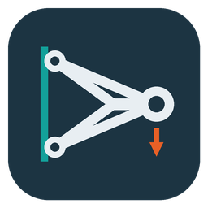
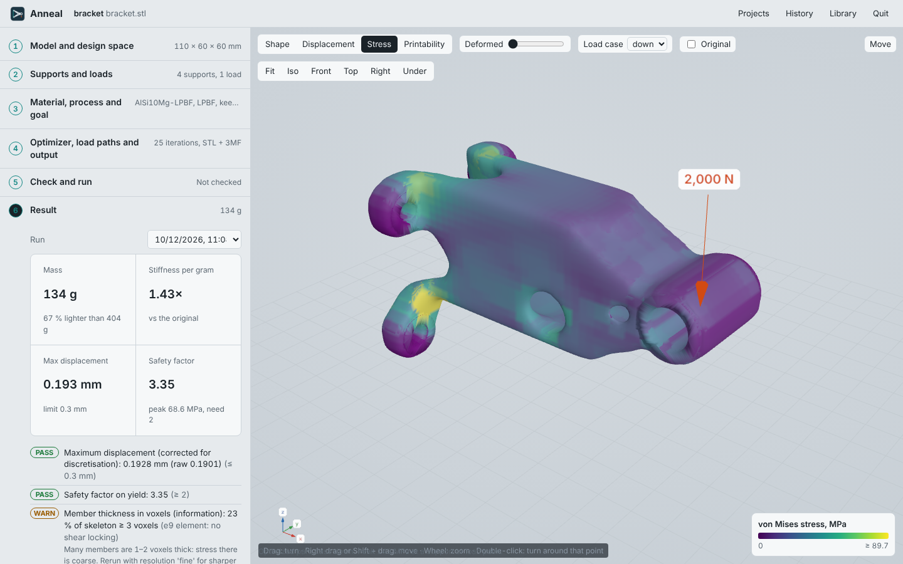

<p align="center"></p>

# Anneal



Anneal makes an existing part lighter and stiffer. You open a model (STL or STEP), click where the
part is held and where it is loaded, and set a goal. Anneal removes the material that does not
carry load, makes a smooth printable surface, solves the new part again to check it, and keeps a
record of every run.

You can use it three ways: the **desktop app** (an icon on your desktop), the **same app in your
browser**, or the **command line** with a spec file. All three write the same files.

```
your-part.step  +  your-part.anneal.json   ──►   your-part-optimized.stl / .3mf  +  report.html
```

More screenshots: [docs/GUI.md](docs/GUI.md). All documents: [docs/README.md](docs/README.md).

It runs on **Windows 10/11** and **Ubuntu 20.04 or newer** (also macOS). It needs no GPU.

---

## 1. Install

### Windows

1. Install **Python 3.11** (or 3.10–3.13) from <https://www.python.org/downloads/windows/>.
   Keep the default options.
2. Unzip Anneal to a folder, for example `C:\Anneal`.
3. Double-click **`install_windows.bat`**. It makes a private environment in `.venv`, installs
   the packages, adds STEP support and the desktop window, puts an **Anneal** icon on the desktop
   and in the Start menu, and runs the solver checks. The last lines must say
   `GATE: OPEN - 6 of 6 checks pass`.

**Updating from 0.1.0:** unzip the new version over the old folder (or into a new folder) and run
`install_windows.bat` again. It is quick the second time; the packages are cached.

### Ubuntu 20.04

Ubuntu 20.04 has Python 3.8, which is too old for current numpy and scipy. The installer gets
Python 3.11 for Anneal only and does not change the system Python.

```bash
cd ~/Anneal
chmod +x install_ubuntu.sh
./install_ubuntu.sh
source .venv/bin/activate
```

### Any system, by hand

```bash
python -m venv .venv
.venv/bin/pip install -e .           # Windows: .venv\Scripts\pip install -e .
.venv/bin/pip install cadquery-ocp   # optional: STEP import
python -m anneal validate
```

---

## 2. Use it

### The app

Open **Anneal** from the desktop or the Start menu (Linux: the applications menu, or `anneal gui`).
On Windows it opens in its own window, drawn by Microsoft Edge WebView2, which is part of
Windows 10/11. Without it, Anneal opens in your browser. Everything stays on your PC: the app is a
small local server at `http://127.0.0.1:8765` and works offline.

1. **Open a part.** Drop an STL, STEP, OBJ or 3MF on the window, or choose one. Each model becomes a
   project in your user folder, in `Anneal Projects\<name>` (for example
   `C:\Users\<you>\Anneal Projects\bracket`). The project folder also holds the spec file, so the
   command line can run the same setup.
2. **Supports and loads.** Click *Add support*, then click a bolt hole or a face on the part.
   A hole becomes a ring around its wall (Anneal measures its diameter); a flat face becomes a thin
   slab on it; *A round patch at the click* selects a spot. Hold Shift to pick several. Then
   *Add load*, click where the force acts, and type the force in newtons and its direction.
   *Add keep-out* keeps a space empty (clearance for a bolt head or a mating part);
   *Add keep-solid* keeps a wall solid. Add load cases if the part sees more than one load.
3. **Material, process and goal.** Pick the material (built in, from your library, or typed for this
   project only, with *Save to my library*). Pick the process (FDM, SLS, LPBF or one of yours) and the
   build direction; *Show printability* colours the faces that need support. Then choose
   *Lightest part that meets the limits* or *Keep a fixed share of the material*.
4. **Optimizer, load paths and output.** Every setting of the spec file is here, with a short
   explanation: iterations, mass-search passes, smallest member, penalty, move limit, edge
   sharpness; the load-path guard (keep every load connected, required density, largest level drop,
   path repair); output formats (STL, 3MF, OBJ, PLY, GLB), smoothing, surface detail, surface
   level, report, and a folder to copy the results to (for example your slicer's folder).
5. **Check and run.** *Check setup* solves the original part at draft resolution in seconds and
   colours it by displacement or stress, so you can see that supports hold and loads push the way
   you expect. *Optimize* runs the full job with a live chart and log. *Stop* ends it.
6. **Result.** Mass, stiffness per gram, displacement and safety factor against the original; every
   check with its fix; *Displacement*, *Stress* and *Deformed* views; the original as a ghost;
   download buttons; star and notes; *Use this run's settings*.

**History** lists every run on this PC, from the app and from the command line, in a database
(`~/Anneal Projects/anneal.db`, SQLite). Search, filter by project, material, passed or starred,
sort by mass or stiffness, add notes (for example what you printed and how it tested), open a run,
reuse its settings in the current project, or tick two runs to compare them: the table shows the
results side by side and only the settings that differ. If the database is lost, Anneal rebuilds
it from the run folders.

**Library** holds materials and processes for all projects (see section 4). **Quit** (top right) stops Anneal. Opening the icon again while Anneal runs shows the running one.

### On Windows, by drag and drop

1. Drag your model (`.stl`, `.step`, `.obj`, …) onto **`Anneal.bat`**.
   Anneal writes `your-part.anneal.json` next to the model and opens it. It also opens
   `your-part-preview.png`, three views of the part on a mm grid.
2. Edit the anchors in the JSON file (see section 3). Use the preview to read coordinates.
   Save the file.
3. Drag the `.json` file onto **`Anneal.bat`**. When the run finishes, the report opens in
   your browser. The optimized part is in `runs\your-part\`.

### From the command line (Windows or Ubuntu)

```bash
anneal inspect part.step            # sizes, volume, closed or not, preview image
anneal init part.step               # writes part.anneal.json (edit the anchors)
anneal run part.anneal.json --open  # optimize, check, report
anneal validate                     # solver checks
anneal materials                    # material library
anneal gui                          # the app in your browser
anneal app                          # the app in its own window
anneal history                      # past runs from the database
anneal shortcut                     # add the desktop / Start menu icon again
```

### Try the example first

```bash
anneal run examples/bracket.json --open
```

`bracket.step` is a solid wall bracket: a 10 mm flange with four M6 holes, and a solid
100 × 30 × 40 mm arm with a 12 mm load bore. The spec loads the bore 2000 N down and 600 N sideways,
keeps a 12 mm clearance hole through the arm, and asks for the lightest part that deflects
0.30 mm or less.

Result from the command line at `normal` resolution (included in `examples/runs/bracket/`): **405 g → 108 g (−73 %)**,
maximum displacement 0.274 mm (limit 0.30), safety factor 2.73, **1.46× stiffer per gram** than the
solid original. Three passes of the mass search, 24 minutes on a 2-core machine.

---

## 3. The spec file

One JSON file per part. It holds only what you know about the job. Everything else (voxel
size, filter radius, surface level, multigrid settings) is derived, and the report lists it.

```jsonc
{
  "name": "bracket",
  "model": "bracket.step",           // STL, OBJ, PLY, OFF, 3MF, GLB, STEP/STP; path relative to this file
  "designSpace": "model",            // see below
  "material": "AlSi10Mg-LPBF",       // `anneal materials` lists them; or an inline {E, nu, density, yield}
  "resolution": "normal",            // draft | normal | fine | {"voxelMM": 1.2} | {"targetElements": 60000}

  "anchors": [
    { "name": "bolt-1", "role": "fixed", "dofs": "xyz", "freezeMM": 3,
      "region": { "type": "pipe", "from": [0,10,10], "to": [10,10,10], "r": 4.4, "rIn": 2.4 } },
    { "name": "load-bore", "role": "load", "freezeMM": 3,
      "region": { "type": "pipe", "from": [95,15,40], "to": [95,45,40], "r": 7.2, "rIn": 5.0 },
      "loads": { "down": [0,0,-2000], "side": [0,600,0] } }      // newtons, one vector per load case
  ],
  "keepOut": [ { "type": "cylinder", "from": [55,10,30], "to": [55,50,30], "r": 6 } ],
  "keep":    [ ],                                              // regions that must stay solid

  "loadCases": { "down": {"weight": 1}, "side": {"weight": 1} },
  "objective": { "minimise": "mass", "volumeFraction": 0.30, "combine": "worst" },
  "optimizer": { "iterations": 70, "massPasses": 5, "minMemberMM": 6,   // minMemberMM optional (auto)
                 "penalty": 3, "move": 0.2, "sharpness": 4 },
  "limits":    { "maxDisplacementMM": 0.30, "minSafetyFactor": 2.0 },
  "loadPaths": { "guard": true, "margin": 0.1, "maxDrop": 0.15, "repair": true },
  "output":    { "formats": ["stl", "3mf"], "smoothing": 10, "upsample": 2,
                 "isoLevel": "auto", "report": true, "copyTo": "D:/Prints/brackets" }   // copyTo optional
}
```

### Design space

| Value | Meaning |
|---|---|
| `"model"` | Material may stay only inside your existing part. The usual choice for lightening a part. |
| `"hull"` (`{"type":"hull","marginMM":5}`) | The convex hull of the part, optionally grown. Lets material move into gaps and corners. |
| `{"type":"bounds","marginMM":5}` | The part's bounding box plus a margin. |
| `{"type":"box","min":[…],"max":[…]}` | A box you type. No model needed: start from rough points in space. |

### Anchors: where the part is held and loaded

Each anchor does three jobs: it selects the grid nodes where the world acts on the part, it
freezes the material near them (`freezeMM`) so the mounting stays, and, as a feature, it can add
geometry.

- `role`: `"fixed"` (held) or `"load"` (loaded). At least one of each.
- `dofs` (fixed only): which directions are held, `"xyz"` (bolted) or for example `"z"` (resting on a surface).
- `loads` (load only): `{ "caseName": [Fx, Fy, Fz] }` in newtons. The force is spread evenly over
  the selected nodes. Different anchors can share case names.
- `torques` (load only, 0.4.1): `{ "caseName": [Mx, My, Mz] }` in newton-metres (N·m). See
  "Torque on a load region" below.
- `region`: what to select. Types: `box` (min, max), `obox` (center, normal, xdir, size: an oriented
  box, which the app makes when you click a flat face), `sphere` (center, r), `cylinder` (from, to, r),
  `pipe` (from, to, r, rIn). **For a hole that is already in the model, use a `pipe` that
  straddles the hole wall:** `rIn` a little inside the hole radius, `r` a little outside.
- `feature`: geometry that Anneal adds and holds. Use it when you start from rough points:
  - `{"bore": {"at": [x,y,z], "axis": [0,0,1], "bolt": "M5", "depthMM": 10}}` — a boss with a
    clearance hole (ISO 273 medium fit). Bolts M2–M12, or `"d"` for any diameter.
  - `{"boltCircle": {"at": […], "axis": […], "dia": 40, "count": 4, "bolt": "M5"}}`
  - `{"pad": {"at": […], "normal": [1,0,0], "w": 30, "h": 30, "t": 3}}` — a flat mounting pad.

### Torque on a load region (0.4.1)

A torque is a pure moment: it turns the region but does not push it. Use it for a drive shaft in
a bore, a lever hub or a motor flange.

```json
{ "name": "hub", "role": "load", "region": { "type": "pipe", "from": [0,0,-5], "to": [0,0,5], "r": 6, "rIn": 4 },
  "torques": { "drive": [0, 0, 12.5] },
  "loads":   { "drive": [0, 200, 0] } }
```

- Units: **N·m**. Anneal multiplies by 1000 and uses N·mm inside the solver. Do not enter N·mm.
- `[Mx, My, Mz]` is a vector about the X, Y and Z axes. The sign follows the right-hand rule:
  point the right thumb along the vector; the fingers show the turn direction.
- Case names are the same as in `loads`. A torque and a force with the same case name act together.
  A case can have a torque and no force.
- `impact` stays a force. An impact on a load region that has only a torque gives an error.

How Anneal puts the torque on the nodes:
1. Anneal finds the centre (the mean position) of the region's nodes on the part.
2. Each node gets a force at a right angle to the line from the centre to the node. The force
   increases linearly with the distance from the turn axis.
3. Anneal sets the size so that the forces add up to zero and their moment about the centre is
   exactly the torque you gave. This is true for any shape of region, also a one-sided one.

This is the same as a rigid hub with a linear shear distribution (the "spider" or RBE3 model in
commercial FEA). It is the smallest set of node forces that gives the torque. The model has no
key, no spline, no contact and no slip in the bore. The report states this rule.

If all the nodes of the region are on one line, a torque about that line has no lever arm. Anneal
then stops with an error. Select a larger region.

**Torque is not bolt preload.** A torque load turns the part in service (a shaft drives a hub).
Bolt preload is the clamp force that a tightening torque makes in a bolt; it pulls the joint
together along the bolt axis. Anneal 0.4.1 does not model bolt preload. Do not enter a bolt's
tightening torque as a `torques` value.

`limits.maxRotationDeg` (optional): the largest permitted twist of a load region, in degrees.
The twist is the rigid rotation that fits the region's node displacements best (least squares).
The result and the report give the twist per load region and load case. Anneal checks the limit
after the run. The optimizer does not use it: to get a stiffer part in torsion, lower
`maxDisplacementMM` or raise `volumeFraction`.

In the app: on a load region, step 2 shows a "Torque" row with Mx, My and Mz in N·m for each load
case, under the force. Leave the fields empty for no torque. The viewer shows the torque as a
curved arrow about its axis. Step 3 has the field "Maximum twist of a load region, degrees".

### Objective

- `volumeFraction`: share of the design space that stays (0.03–0.95).
- `"minimise": "mass"` with `limits.maxDisplacementMM`: Anneal searches for the lightest
  volume fraction that meets the displacement limit (up to 5 passes, each later pass
  starts from the previous design). Without it, the volume fraction is used as given.
- `combine`: `"sum"` (weighted total stiffness) or `"worst"` (stiffest worst case, a p-norm).

### Optimizer, load paths and output

| Key | Default | Meaning |
|---|---|---|
| `optimizer.iterations` | 80 | Iterations per pass. 60+ for a part you make; under 25 Anneal warns. |
| `optimizer.massPasses` | 5 | Most passes in the lightest-part search. |
| `optimizer.minMemberMM` | auto | Smallest member (sets the filter radius). Auto: 6 voxels or 2 × the material's minimum wall. |
| `optimizer.penalty` | 3 | SIMP penalty for grey material. |
| `optimizer.move` | 0.2 | Largest density change per iteration. |
| `optimizer.sharpness` | 4 | Heaviside projection strength. 0 turns it off; above 8 can stall. |
| `loadPaths.guard` | true | Before the surface is made, check that every load connects to a support. |
| `loadPaths.margin` | 0.1 | Density the connection needs above the surface level. |
| `loadPaths.maxDrop` | 0.15 | Largest drop of the surface level allowed to reconnect a load. |
| `loadPaths.repair` | true | If still cut, add material along the cheapest path. |
| `output.formats` | stl, 3mf | Also obj, ply, glb. STL is always written. |
| `output.smoothing` | 10 | Taubin smoothing passes on the surface. |
| `output.upsample` | 2 | Surface detail: 1 = voxel size, 2 or 3 = finer (larger files). |
| `output.isoLevel` | auto | Surface level. Auto keeps the optimized volume; a number 0.1–0.9 (lower = thicker). |
| `output.report` | true | Write the HTML report. |
| `output.copyTo` | – | Also copy the part files to this folder. |

### 0.4 options: print-aware material, buckling, impact, large deformation (all off by default)

Runs without these keys give the same result as 0.3.0 (checked bit for bit, see `VERIFICATION.md`).

```json
"process": "FDM",
"material": { "E": 3500, "nu": 0.36, "density": 1.24, "yield": 50, "Ez": 2400, "zStrengthFactor": 0.5 },
"physics":  { "anisotropic": true, "buckling": true, "nonlinear": true },
"impact":   { "drop": { "anchor": "load-bore", "massKg": 0.5, "dropHeightMM": 1000, "direction": [0, 0, -1] } },
"limits":   { "minBucklingFactor": 2.0, "minImpactSafetyFactor": 1.0 }
```

| Key | What it does |
|---|---|
| `physics.anisotropic` | Print-aware material. Stiffness E in the layers, `Ez` across them (`nuZ` and `Gz` optional; if left out, nuZ = nu and Gz = Ez / (2(1 + nuZ)), and the run says so). Strength is checked with the Hill criterion: in-plane strength = yield, across layers = yield × zStrengthFactor, shear strengths assumed X/√3 and Z/√3. The safety factor is the lower of von Mises and Hill. Needs a process with a build direction. |
| `physics.buckling` or `limits.minBucklingFactor` | Linear buckling of the as-built part for each load case. The factor is multiplied by the shear-locking factor so it stays conservative (check V7). Default limit 2.0. Takes from about a minute to several minutes per load case. |
| `impact` | Equivalent-static impact. A mass (`massKg`) moving at `speedMS`, or falling from `dropHeightMM`, hits a load region (`anchor`) along `direction`. Anneal finds the part's stiffness k at that region, the peak force F = √(2·E·k), and checks stress (and layers, with a process) at that force against `minImpactSafetyFactor` (default 1.0). It ignores the part's own mass, stress waves, rate effects and yielding, so use it for a stiff part hit by a heavier, slower object. |
| `physics.nonlinear` | Large-deformation check with CalculiX: the exported part is meshed into tetrahedra with gmsh and solved linear and with large deflection (NLGEOM) for each load case. A difference above 10 % is flagged. Optional `physics.nonlinearMeshMM` (default about 2 mm). No plasticity. |

**Large-deformation check: install CalculiX and gmsh** (separate GPL programs, not part of Anneal).
Ubuntu: `sudo apt install calculix-ccx` and `pip install gmsh`. Windows: `pip install gmsh`, download
CalculiX for Windows (`ccx.exe` with its DLLs) from www.dhondt.de, and put its folder on the PATH or set
`ANNEAL_CCX` to the full path of `ccx.exe`. Without them the check is skipped with a note; the run goes on.

### Picking features, keeping geometry, and growing a part (0.4)

- **Click a hole, a boss or a face.** Anneal recognises the feature, also on coarse STEP meshes where
  a hole has only 6 to 12 facets. A hole picked as a support or load gets `"hole": true`: the hole
  stays open, and `"boltAccessMM"` keeps room for the bolt head or nut at both ends.
- **Keep-outs and keep regions follow the feature.** A keep-out picked on a face is that face's exact
  outline pushed out by a depth (`"type": "prism"`); on a hole it is a cylinder with a clearance. A
  "Keep a feature" region on a face or hole keeps that wall of the original part.
- **Exact geometry** (`"output": {"exactFeatures": true}`, on for new projects in the app): the
  exported part gets the model's exact geometry back at supports, loads and kept regions, and the
  keep-outs are cut exactly. Bolt holes come out at their true diameter instead of smoothed.
  Uses manifold3d (Apache-2.0).
- **Does Anneal add or remove material?** It puts material where it helps, inside the design space.
  With `"designSpace": "model"` it can only remove. With `bounds`, `hull` or `box` it can also add
  material outside the original part.
- **Grow a part from bolt-on points:** import a STEP that holds only the interfaces (mounting pads,
  lugs, flanges), use `"designSpace": {"type": "bounds", "keepModel": true}`, pick the holes as
  supports and loads, add keep-outs for neighbouring parts, and run. The interfaces are kept exactly
  and material is added to join them. Example: `examples/interfaces.json` (model made by
  `examples/make_interfaces.py`).
- **Viewer:** drag turns the view; right drag, Shift + drag, the arrow keys or the *Move* button move
  it; double-click turns the view around the clicked point.

### Limits and checks

| Check | How it is measured |
|---|---|
| Maximum displacement | Re-solve of the **exported surface** (not the density field), corrected for shear locking |
| Safety factor | Material yield / peak von Mises stress (99.5th percentile at element centres, away from the support and load points) |
| Members ≥ 6 voxels thick | Skeleton of the as-built part. Thinner members are modelled too stiff, so displacement is scaled up by the measured factor (warning, not failure) |
| Thinnest member vs process | 2nd-percentile member thickness vs the material's minimum wall |
| Safety factor (Hill, print-aware) | With `physics.anisotropic`: the lower of von Mises and Hill (layer strength = yield × zStrengthFactor) |
| Buckling load factor | With `physics.buckling`: lowest linear buckling factor per load case × locking factor, vs `minBucklingFactor` (default 2) |
| Impact | With `impact`: safety factor (and across layers) at the equivalent peak force, vs `minImpactSafetyFactor` (default 1) |
| Large deformation | With `physics.nonlinear`: CalculiX large-deflection displacement vs `maxDisplacementMM`; warning if it differs from linear by more than 10 % |
| Twist of load regions | With `limits.maxRotationDeg` (0.4.1): least-squares rigid rotation of each load region's nodes, in degrees, vs the limit |

A failed check prints the fix, for example "Raise objective.volumeFraction".

---

## 4. Materials, processes and printability

### Materials

Built in (typical datasheet values; replace them with your own coupon data when you have it):
PLA-FDM, PETG-FDM, PA12-SLS, AlSi10Mg-LPBF, Ti64-LPBF, 316L-LPBF. `anneal materials` lists them with
their values.

Your own materials and processes are saved in `Anneal Projects/library.json`. Updates of Anneal never
change that file. Four ways to add materials:

| Way | How |
|---|---|
| Import a file | Library page → *Import materials from CSV or JSON*, check the preview, save. Or `anneal materials import file.csv` (`--dry-run` to only check, `--keep-existing` to not replace). |
| Type one | Library page → *Add material*, or *Copy to edit* on a built-in one. Or `anneal materials add "PETG-CF" --E 3800 --nu 0.35 --density 1.25 --yield 52 --z-factor 0.58 --process FDM`. |
| From a project | Step 3 → *Custom (this project only)* → *Save to my library*. |
| From another PC | *Export my library* there (or `anneal materials export`), then import the JSON here. |

Import files: one row per material, a header row with the column names. Anneal recognises usual
datasheet names (`Tensile Modulus`, `Young's modulus`, `E`, `Poisson's ratio`, `Density`,
`Yield strength`, `Tensile strength`, `Z strength`, `Process`, `Min wall`, `Note`) and converts units
written in the header (`E (GPa)`) or in the cell (`3.8 GPa`): GPa, MPa, psi, ksi, g/cm³, kg/m³, lb/in³,
mm, in. Commas, semicolons, tabs and decimal commas work. A Z (layer) strength column becomes the
layer-strength factor. Every skipped row is reported with its row number and the fix. Process names
FFF→FDM, MJF→SLS, SLM/DMLS→LPBF are mapped.

```
name,E (GPa),Poisson,density (g/cm3),yield (MPa),Z strength (MPa),process,min wall (mm),note
PETG-CF Bambu,3.8,0.35,1.25,52,30,FDM,0.8,Bambu Lab TDS 2024
Inconel 718,200,0.29,8.19,1034,,LPBF,0.4,
```

Every change to your library (added, replaced, edited, removed, with the source file and the values
before and after) is kept in the library's change history: Library page, or `anneal materials log`.
Runs keep a full copy of the material values they used, so old runs stay correct if you change the
library later. History can be filtered by material.

### Processes and printability (DFM)

Design for manufacturing (DFM) means the part can actually be made by the chosen process, not only
that it is strong enough. A process profile holds the rules; Anneal checks the exported part against
them after every run:

| Check | Rule | FDM | SLS | LPBF |
|---|---|---|---|---|
| Build volume | Part fits the machine, height along the build direction | 256 mm cube | 300 mm cube | 250 × 250 × 325 |
| Minimum wall | Thinnest member ≥ the larger of material and process minimum wall | 0.8 mm | 0.8 mm | 0.4 mm |
| Minimum hole | Smaller holes print out of round: print undersize, then drill | 2.0 mm | 1.5 mm | 1.0 mm |
| Overhang | Downward faces steeper than this from vertical need support; support volume estimated; best of the six axis directions suggested | 45° | none needed | 45° |
| Closed cavities | Powder is trapped in closed cavities | allowed | not allowed | not allowed |
| Layer strength | Tension across the layers vs yield × layer-strength factor | × 0.5 | × 0.9 | × 0.9 |

The order is: process profile → the material's own layer-strength factor → values typed in the
project. Copy a built-in process in the Library to make your own printer (for example "Bambu X1C" with
your build volume and the overhang angle you trust). The *Printability* view colours faces that need
support (amber) and faces on the build plate (dark) for any build direction; *Under* looks up from
the plate. The checks report what the printer will see; they do not yet steer the optimization
itself (an overhang filter inside the optimizer is in testing for a later release).

In the spec file:

```jsonc
"material": "PETG-CF Bambu",
"process": { "name": "FDM", "buildDirection": [1, 0, 0], "maxOverhangDeg": 50 },  // or "FDM", or "none"
```

## 5. Output (`runs/<name>/`)

| File | Content |
|---|---|
| `<name>-optimized.stl`, `.3mf` | The part, closed and smoothed, in the model's coordinates |
| `report.html` | Key numbers, 3D view (original vs optimized), checks, per-case table, convergence, density views, derived values |
| `run.json` | Run record: versions, input and output SHA-256 hashes, material, every derived value, results, checks |
| `density.npy` | Optimized density field (numpy array, `[i, j, k]` on the grid) |
| `spec.json` | Copy of the spec used |

---

## 6. How it works

```
model ──► voxelize (fill fractions) ──► anchors, keep-outs, frozen regions
      ──► SIMP optimization on the voxel grid (hex8 FEM, multigrid-preconditioned CG,
          density filter, penalty ramp, then Heaviside projection to sharpen the design)
      ──► load-path guard ──► smooth surface (marching cubes + Taubin) ──► voxelize the surface again
      ──► as-built re-solve ──► checks ──► report + run record
```

| Module | Job | CEM layer |
|---|---|---|
| `kernel.py` | Frames and base shapes (box, sphere, cylinder, pipe), fastener table | Shape kernel (ShapeKernel's role) |
| `geometry.py` | STL/STEP import, fill-fraction voxelizer | Geometry kernel (PicoGK's role) |
| `fem.py` | Hex8 voxel FEM, partial volumes, AMG-preconditioned CG, stress | Physics (Anneal.Solve) |
| `optimize.py` | SIMP, density filter, penalty continuation, Heaviside projection, OC, multi-load | Optimizer |
| `problem.py` | Spec → grid, anchors, guard rails with fixes | Engineering model |
| `export.py`, `run.py`, `report.py` | Load-path guard, surface, as-built re-solve, checks, mass search, record | Run harness |
| `pick.py` | Click on the model → hole (fitted cylinder), flat face (oriented slab) or patch | GUI |
| `fields.py` | Displacement and stress at the corners of the displayed mesh | GUI |
| `db.py` | Run history in SQLite, rebuilt from run folders if needed | Record |
| `materials.py` | Built-in and your materials and processes, import (CSV/JSON, units), change history | Library |
| `dfm.py` | Build volume, wall, hole, overhang and support, best direction, cavities, layer strength | Printability |
| `gui/server.py`, `gui/desktop.py`, `gui/static/` | Local server, desktop window, page (three.js r160, MIT, included) | GUI |
| `validate.py` | 6-check solver gate | Validation |

Design rules carried over from the Phase 0 spike:

- **One grid, no mesh.** Each voxel is a trilinear brick. Partial voxels use their fill fraction
  as stiffness with penalty 1 (V4: binary voxels give 6.67 % error on a bar 6.4 cells deep; fill
  fractions give exact results).
- **Multigrid before GPU.** Smoothed-aggregation AMG (pyamg) with the six rigid-body modes keeps
  CG near 15–30 iterations. The hierarchy is rebuilt only when CG iterations grow.
- **Members at least 6 voxels thick** by default (filter radius = 3 voxels), and a correction
  where they are thinner.
- **Sharpen before you threshold.** After the penalty ramp, a Heaviside projection (sharpness 1 → 4)
  pushes densities toward 0 or 1, so the optimizer sees almost the part that is exported. On the
  draft bracket this gave 9 % better stiffness per gram in the exported part than thresholding a
  grey field.
- **Never cut a load path.** Before the surface is made, every load anchor must connect to a support
  through material clearly above the iso level. If not, the level drops a little (at most 0.15);
  as a last resort, material is added along the cheapest path (Dijkstra). The log says when either happens.
- **Re-solve the as-built part.** The reported numbers come from the exported surface.
- **Deterministic.** The same inputs on the same machine give bit-identical results (V5).

### Validation gate (`anneal validate`)

| Check | Expected |
|---|---|
| V1 rigid-body motion stores no energy | < 1e-10 |
| V2 uniform tension equals FL/(AE) | exact to 1e-8 |
| V3 cantilever vs Timoshenko | 86.9 % (2 deep), 95.7 % (4 deep), 98.3 % (8 deep) |
| V4 partial volume vs binary | binary 6.67 % error, partial exact |
| V5 deterministic reruns | identical SHA-256 |
| V6 SIMP vs uniform at equal mass | about 92 % lower compliance |
| V7 buckling vs Euler (column 4 voxels across) | raw +3.5 %, corrected −1.0 % (must be −3 % to 0 %) |
| V8 print-aware stiffness and Hill strength | E and Ez exact; Hill = von Mises when strengths are equal |
| V9 impact force on a bar | k = EA/L and F = √(2Ek) within 2 % and 1 % |

Tests: `pip install pytest` then `python -m pytest -q` (52 tests, 25–35 minutes on 2 cores).
`VERIFICATION.md` lists the release evidence: tests, gate, a bit-for-bit comparison with 0.3.0, and
independent checks with CalculiX and PrusaSlicer.

---

## 7. Limits — read before you print

- Linear elastic, small displacement, static loads. Isotropic unless `physics.anisotropic` is on.
  Buckling is linear (eigenvalue) only and opt-in. No fatigue, contact, thermal, impact or
  large-deflection analysis in Anneal's own solver: impact is an equivalent static check, and
  large deformation is checked with CalculiX when it is installed.
- Stress is an estimate at element centres. Support and load points have high local stress in any
  linear model, so they are left out of the peak. Check critical parts with an independent analysis.
- FDM parts are anisotropic. Z strength can be under half the listed yield.
- Material values are typical datasheet figures. Replace them with your own coupon data in `materials.py`.
- Bolted holes are modelled as fully fixed walls. This is stiffer than a real joint.
- Printability checks report; they do not steer the optimizer yet. The support volume in the report
  is the space under overhangs; slicers fill it
  sparsely (on the example bracket the slicer used about 0.18 of it).
- Flexible materials (TPU and similar, E under about 200 MPa) are outside the linear model.
- Voxel count sets run time. On a 2-core machine: `draft` about 2 minutes per pass, `normal` about
  10 minutes for the first pass and 4 for each later pass, `fine` about 30. The example bracket with
  the mass search takes about 20–25 minutes at `normal`. Use `draft` to set up a spec, then `normal`.
- Use 60 or more iterations for a part you will make. Under 25, the design stays grey and the
  exported part comes out heavier than the target (Anneal warns you).

## 8. Next steps on the plan

- PicoGK backend for `kernel.py` and `geometry.py` on Windows and macOS (lattice infill, exact offsets).
- Lattice grading from grey density, instead of thresholding it.
- Explicit impact (Chrono or OpenCourant) for events the equivalent-static check cannot cover.
- Overhang filter inside the optimizer (built and tested on branch verify-roadmap; held back from 0.4).
- Minimum-size constraint that holds after thresholding (robust formulation).
- Slicer in the loop (PrusaSlicer / OrcaSlicer command line).
- Buckling as a constraint inside the optimizer (KS aggregate with MMA).

Third-party licences: numpy, scipy, scikit-image, matplotlib (BSD-3), pyamg, trimesh, three.js (MIT),
optional pywebview (BSD-3), optional cadquery-ocp / OpenCASCADE (LGPL-2.1 with the OCCT exception).
