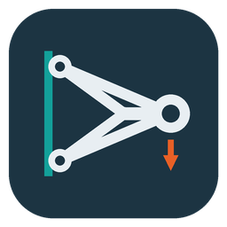
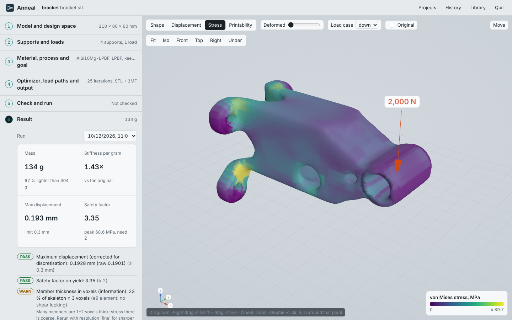

<p align="center"></p>

# Anneal

Anneal makes an existing part lighter and stiffer. It runs topology optimization on a voxel grid.
It needs no mesh and no GPU.



## What it does

1. You open a model (STL or STEP).
2. You click where the part is held and where it is loaded.
3. You set a goal, for example "the lightest part that bends 0.30 mm or less".
4. Anneal removes the material that does not carry load.
5. Anneal makes a printable surface and solves the new part again to check it.
6. Anneal writes the part, an HTML report and a record of the run.

```
part.step  +  part.anneal.json   ──►   part-optimized.stl / .3mf  +  report.html  +  run.json
```

You can use the desktop app, the same app in a browser, or the command line. All three use the
same spec file and write the same output.

## Example result

The example bracket is made from AlSi10Mg (LPBF). Four bolt holes hold it. The bore has a load of
2000 N down and 600 N to the side. The limit is 0.30 mm displacement.

| | Original | Optimized |
|---|---|---|
| Mass | 405 g | 108 g (−73 %) |
| Maximum displacement | — | 0.274 mm |
| Safety factor | — | 2.73 |
| Stiffness per gram | 1.00× | 1.46× |

The run takes about 25 minutes at `normal` resolution on a 2-core computer.

## Quick start

Requirements: Windows 10/11, Ubuntu 20.04 or newer, or macOS. Python 3.10 to 3.13. No GPU.

**Windows.** Install Python from python.org. Unzip Anneal. Double-click `install_windows.bat`.
The installer adds an **Anneal** icon to the desktop and the Start menu.

**Ubuntu.** Run `./install_ubuntu.sh`, then `source .venv/bin/activate`.

**Any system.**

```bash
python -m venv .venv
.venv/bin/pip install -e .           # Windows: .venv\Scripts\pip install -e .
.venv/bin/pip install cadquery-ocp   # optional: STEP import
anneal validate                      # solver gate: all checks must pass
anneal run examples/bracket.json --open
```

Main commands:

| Command | Job |
|---|---|
| `anneal app` | Open the app in its own window |
| `anneal gui` | Open the app in your browser |
| `anneal init part.step` | Write a starter spec for a model |
| `anneal run part.anneal.json` | Optimize, check and write the report |
| `anneal validate` | Run the solver validation gate |
| `anneal materials` | List, import or add materials |
| `anneal history` | List earlier runs |
| `anneal doctor` | Check Python, packages and start-up |

## How it works

```
model ──► voxels (fill fractions) ──► supports, loads, keep-outs
      ──► SIMP optimization (hex FEM, multigrid-preconditioned CG, filter, projection)
      ──► load-path guard ──► surface ──► as-built re-solve ──► checks, printability, report
```

- **One grid, no mesh.** Each voxel is a brick element. Partial voxels use their fill fraction.
- **The reported numbers come from the exported part**, not from the density field.
- **Every load stays connected** to a support before the surface is made.
- **The same inputs give the same output**, bit for bit, on the same machine.
- **A validation gate** (`anneal validate`) compares the solver with closed-form results.

## Limits

Anneal is a linear-elastic, static solver. It does not analyse fatigue, contact or heat flow.
Material values are typical datasheet values. Bolted holes are modelled as fully fixed walls.
Read [Limits — read before you print](docs/USER-GUIDE.md#7-limits--read-before-you-print) before
you make a part. Do an independent check of a critical part.

## Documents

| Document | Contents |
|---|---|
| [docs/USER-GUIDE.md](docs/USER-GUIDE.md) | Full manual: install, app, command line, every spec key, materials, printability, output, limits |
| [docs/GUI.md](docs/GUI.md) | Screenshots of the app |
| [docs/guides/NEW-PART.md](docs/guides/NEW-PART.md) | How to set up a new part, with a load-case checklist |
| [docs/VV-STRATEGY.md](docs/VV-STRATEGY.md) | How the results are verified and validated |
| [CHANGELOG.md](CHANGELOG.md) | Changes in each release |
| [docs/README.md](docs/README.md) | Index of all documents |

## Licence

Anneal is proprietary, for personal use. Third-party packages: numpy, scipy, scikit-image,
matplotlib (BSD-3); pyamg, trimesh, three.js (MIT); manifold3d (Apache-2.0). Optional: pywebview
(BSD-3); cadquery-ocp / OpenCASCADE (LGPL-2.1 with the OCCT exception); gmsh and CalculiX are
separate GPL programs, used only through files.
