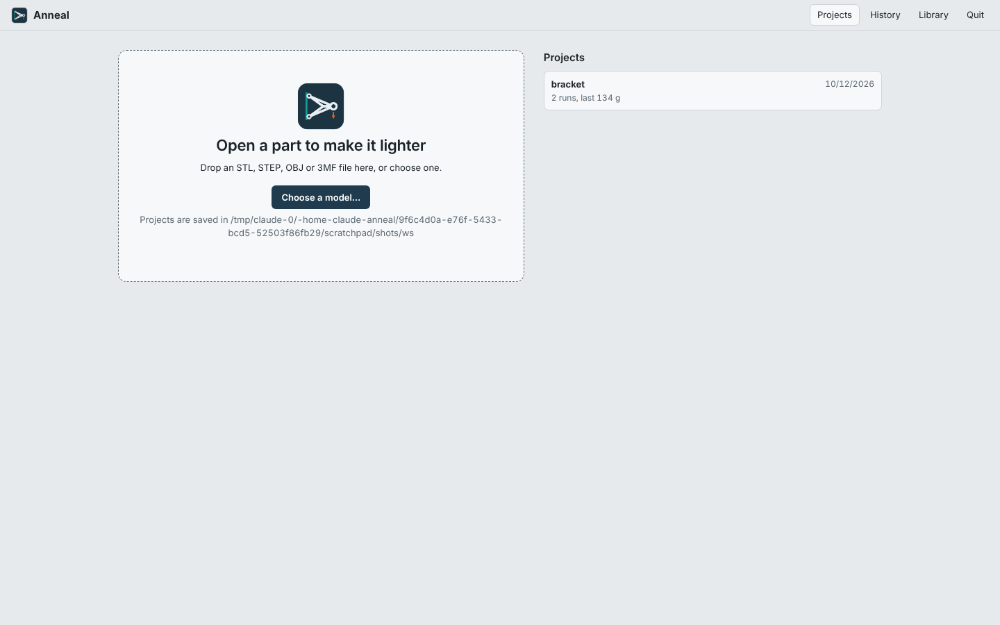
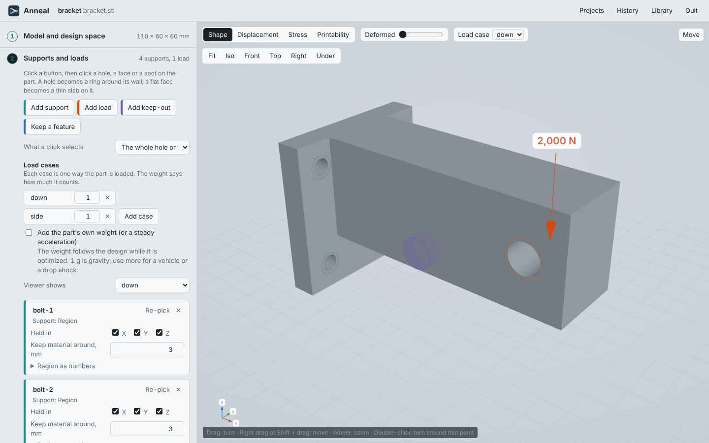
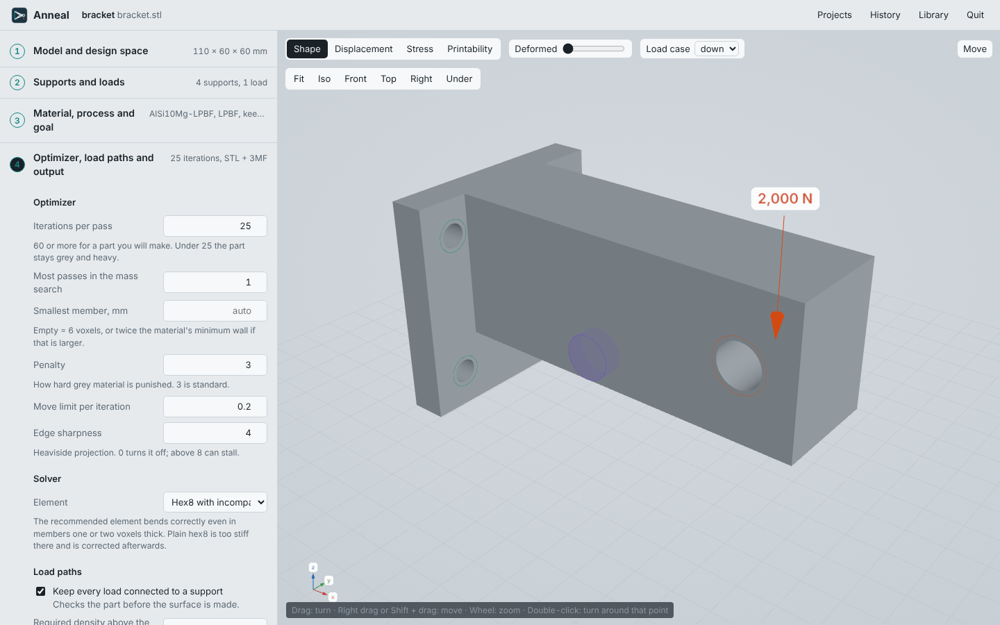
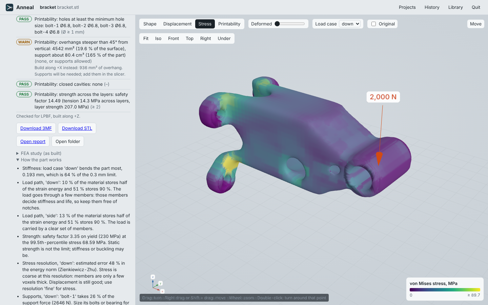
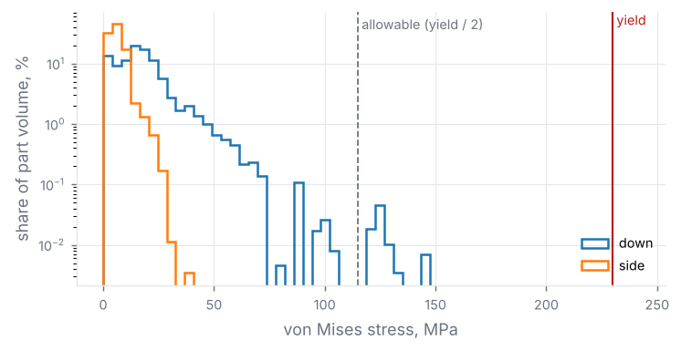
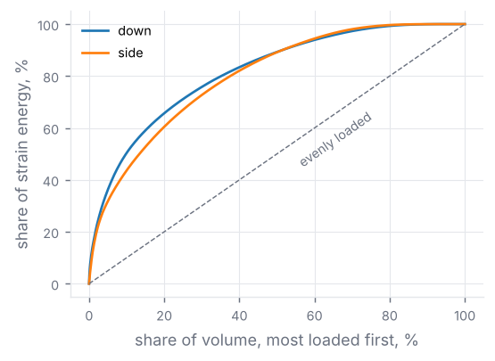

# What the Anneal app looks like

Screenshots of release-0.4 (0.4.0 preview) in a 1440 × 900 window. The part is the example bracket
(`examples/bracket.json`): AlSi10Mg (LPBF), four bolt holes held, 2000 N down and 600 N sideways
on the bore, a keep-out cylinder. The run used 2.5 mm voxels and 25 iterations (a quick run for the
pictures; use "normal" or "fine" for a part you will make).

## Start page
Open a model or a recent project.

## Step 2 — supports and loads
Click a hole or a face, then set the forces per load case. The panel also holds the load cases and
the own-weight (acceleration) option. Supports show as teal rings, loads as an orange arrow with the
force, keep-outs in violet.

## Step 4 — optimizer, solver and output
Iterations, member size, penalty, the solver element (e9 by default), load-path guard, and output
(formats, edges, detail, exact features, advanced output).

## Step 6 — result
Mass, stiffness per gram, displacement and safety factor; every check with PASS / WARN / FAIL and
the fix; the part coloured by von Mises stress (also displacement and printability).

Further down: downloads, the FEA study, and "How the part works" (plain statements about load path,
margins, stress resolution and supports).

## Advanced output graphs (also in the report)

| Stress distribution | Load-path concentration |
|---|---|
|  |  |

## Logo

The logo shows the idea: a wall support (teal), a load (orange arrow) and the lightest structure
between them.
